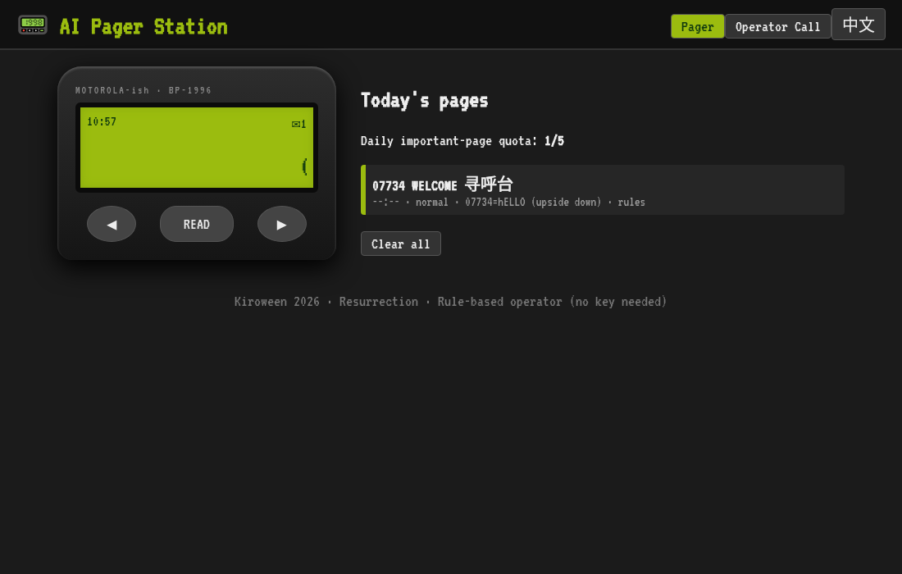

# 📟 AI Pager Station · AI 寻呼台

> The 1990s pager is back — and the pager-station operator is now an AI.
> Kiroween 2026 · Category: **Resurrection**



## What it is
In 1990s China, you called a **寻呼台 (pager station)**, a human operator asked *"请问您要呼几号？"* ("Which number are you paging?"), and squeezed your message onto a tiny green screen. Lovers sent **520** (I love you), colleagues sent **9958** (urgent!).

AI Pager Station brings that back as an antidote to notification overload: paste long messages, group-chat dumps or emails, and an AI operator compresses each into a **≤20-character page**, triages importance, and buzzes you only a few times a day. Everything else lands in one daily digest page.

## Resurrection angle
Dead tech: the pager + the human operator. Modern AI: an LLM operator that summarizes, triages and speaks in authentic numeric codes. The constraint of a 20-character LCD turns out to be a great UX for calm, focused communication.

## Features
- AI compression to ≤20 chars (EN & 中文), with deterministic **rule-based fallback** — works with no API key
- Importance triage, daily quota of 5 important pages, low-priority **daily digest**
- Numeric code dictionary: 520, 1314, 9958, 886, 7456, 555, 530, 143, 911, 07734 …
- Retro pager device: green LCD, VT323 pixel font, scrolling text, WebAudio beep, vibrate animation
- "Operator call" screen styled like a 寻呼台 hotline; group-chat dump mode
- Bilingual EN / 中文 toggle; pages persisted in localStorage

## How Kiro was used
See [KIRO_USAGE.md](KIRO_USAGE.md) (draft). The initial scaffold was generated with an AI assistant outside Kiro; the `.kiro` folder is the spec-driven plan that development will continue from in the Kiro IDE:
- **Specs** (`.kiro/specs/`): EARS-style requirements, design and task lists for the compression engine and the retro UI.
- **Steering** (`.kiro/steering/`): product, tech and structure rules (20-char invariant, zero deps, no-key fallback).
- **Hooks** (`.kiro/hooks/`): configured to auto-update tests on engine edits, enforce the 20-char limit, keep i18n strings in sync.
- **Vibe coding** for the visual pager design and copywriting.

## Run locally
```bash
npm test        # unit tests
npm run build   # static build -> dist/
npm start       # http://localhost:3000
```
No dependencies to install (Node ≥ 18).

## Environment variables (optional)
| Var | Purpose |
|---|---|
| `AI_API_KEY` | Key for any OpenAI-compatible API. Unset → rule-based operator |
| `AI_BASE_URL` | Default `https://api.openai.com/v1` |
| `AI_MODEL` | Default `gpt-4o-mini` |
| `PORT` | Local port, default 3000 |

## API
`POST /api/page` `{"text": "...", "sender": "Boss"}` → `{"page","code","priority","score","mode"}`
`GET /api/health` → `{"ok":true,"ai":false}`

## Deploy (free)
**Vercel:** import the repo; `vercel.json` builds static files to `dist/` and `api/page.js` becomes a serverless function. Add env vars in project settings (optional).
**Netlify (recommended, no phone verification):** in Netlify choose *Add new site → Import an existing project → GitHub* and pick this repo. `netlify.toml` sets everything: build command `npm run build`, publish dir `dist`, functions dir `netlify/functions`, and redirects `/api/page` and `/api/health` to Netlify Functions. No env vars required (rule-based compression works offline); optionally add `AI_API_KEY` (and the other vars in `.env.example`) under Site settings → Environment variables.

**Render / Railway / Fly:** run `npm start` as a Node web service.

## Screenshots
`docs/screenshot.png` (more to come)

## License
MIT © 2026 Hongyan Li
